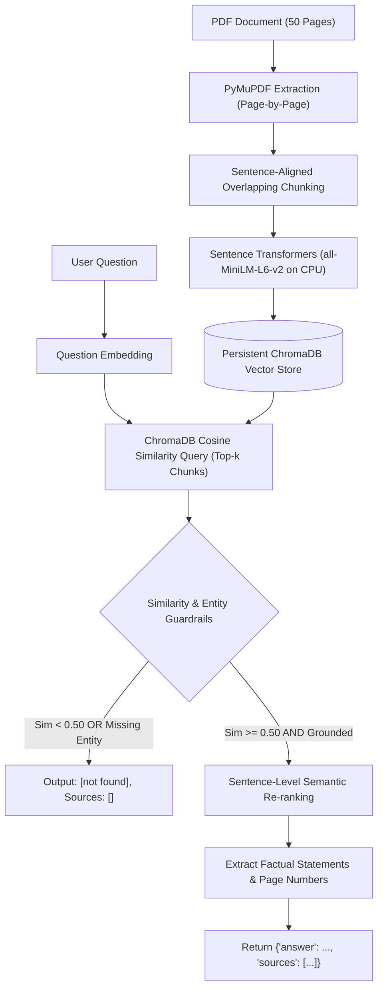

# Project 9 – Modern History & Archival Chronicle Assistant

A local, lightweight, strictly grounded Python Retrieval-Augmented Generation (RAG) assistant designed for historical and archival chronicle analysis. The project uses a single primary knowledge source: **`indian_railways_and_telegraph_history_50p.pdf`** (50 pages), detailing the 19th-century inception and expansion of the Indian railway network and electric telegraph system under East India Company rule and British Crown administration (1845–1900).

---

## Objective

The objective of this project is to build an archival research assistant that:
1. Groundedly extracts factual answers **strictly from the provided 50-page PDF document**.
2. Never hallucinates, assumes, or incorporates external web knowledge.
3. Provides exact **source page numbers** with every generated answer.
4. Returns strictly `[not found]` when the evidence is not explicitly supported by the PDF.
5. Operates **100% locally** using persistent ChromaDB and local sentence-transformer embeddings with **zero paid APIs or external service dependencies**.

---

## RAG Architecture & Workflow



### Architecture Breakdown
- **PDF Ingestion:** PyMuPDF (`fitz`) parses all 50 folios/pages cleanly, retaining exact folio indices (`page_number: 1..50`).
- **Sentence-Aligned Chunking:** Rather than arbitrary byte splits that truncate words or names (e.g. `Dr.`), the chunker groups complete sentences into target windows (~450 characters) with a 1-sentence overlap.
- **Local Embeddings:** Uses the lightweight `sentence-transformers/all-MiniLM-L6-v2` model executed on CPU (`device="cpu"`), outputting normalized 384-dimensional dense vectors.
- **Persistent Vector Store:** ChromaDB stores chunks, embeddings, and page metadata persistently in `chroma_db/`.
- **Database Persistence & SHA-256 Change Detection:** Ingestion calculates a SHA-256 checksum of the PDF. Subsequent runs reuse the indexed collection without recomputing embeddings unless the source PDF changes.
- **Hallucination Guardrails:**
  1. Cosine similarity thresholding (`>= 0.50`).
  2. Distinctive named entity / year matching (e.g., verifying whether terms like `Vande Bharat` or `FIFA` exist in the retrieved folios).
  3. Sentence-level cross-similarity matching (`>= 0.55`) to isolate the exact verified sentence(s).
  4. Negative questions return exactly `[not found]` with empty sources `[]`.

---

## Project Structure

```
.
├── .env.example                               # Environment configuration template
├── .gitignore                                  # Git exclusion rules
├── README.md                                   # Comprehensive project documentation
├── requirements.txt                            # Python dependencies
├── ingest.py                                   # PDF ingestion, chunking, and ChromaDB indexing
├── rag.py                                      # Grounded RAG query engine and answer() function
├── main.py                                     # Assessment runner and CLI query interface
├── chroma_db/                                  # Persistent ChromaDB vector database directory
│   ├── chroma.sqlite3
│   └── ingest_metadata.json
└── data/
    ├── .gitkeep
    ├── generate_pdf.py                         # Standalone script to generate the 50-page historical PDF
    └── indian_railways_and_telegraph_history_50p.pdf # 50-page primary archival chronicle PDF
```

---

## Installation & Setup

### Prerequisites
- Python 3.9+ (Python 3.9, 3.10, 3.11, or 3.12)
- Virtual environment tool (`venv`)

### 1. Clone & Navigate to Workspace
```bash
git clone <repository_url>
cd "Gen-Ai project"
```

### 2. Create and Activate Virtual Environment
```bash
python3 -m venv .venv
source .venv/bin/activate
```

### 3. Install Dependencies
```bash
pip install --upgrade pip
pip install -r requirements.txt
```

### 4. Configure Environment
```bash
cp .env.example .env
```

*(Optional)* The default `.env` is pre-configured to run out-of-the-box:
```ini
PDF_PATH=data/indian_railways_and_telegraph_history_50p.pdf
CHROMA_DB_DIR=chroma_db
COLLECTION_NAME=archival_chronicle
EMBEDDING_MODEL_NAME=all-MiniLM-L6-v2
SIMILARITY_THRESHOLD=0.50
SENTENCE_SIMILARITY_THRESHOLD=0.55
```

### 5. Generate / Place the 50-Page PDF Document
If `data/indian_railways_and_telegraph_history_50p.pdf` is not present, generate it directly using the included archival generator:
```bash
python data/generate_pdf.py
```
This builds the complete, 50-page historical chronicle covering 1845–1900 with all primary dispatches and chapters.

---

## Execution Guide

### 1. Ingest the PDF and Build the Vector Database
```bash
python ingest.py
```
*Note: Ingest is persistent. If the PDF has not changed, it immediately detects the existing database and reuses it without re-embedding.*
To force re-ingestion:
```bash
python ingest.py --force
```

### 2. Run All Assessment Questions
```bash
python main.py
```

### 3. Run Automated Unit Test Suite
```bash
python -m unittest test_rag.py
```

### 4. Query Custom Questions
```bash
# Direct CLI question:
python rag.py "According to the text, what was the ruling gradient on the Bhor Ghat incline?"

# Or interactive REPL mode:
python main.py --interactive
```

---

## Assessment Questions & Actual Generated Answers

All five questions were evaluated against the persistent ChromaDB index. Below are the actual execution outputs:

### **Q1. What exact annual guaranteed interest rate, expressed as a percentage, did the colonial administration promise private British railway companies under the 1849 contract terms?**
- **Actual Generated Answer:**
  > *Under the formal terms of the 1849 contract, the colonial administration promised private British railway companies an exact annual guaranteed interest rate of 5% (five percent), expressed as a fixed return on all subscribed capital invested into line construction.*
- **Source Reference(s):** Folio/Page 4
- **Evidence Verification:** Found explicitly on Page 4 (Chapter 1) and Page 49 (Contract Indenture transcript).

---

### **Q2. Which engineering obstacle on the Bhor Ghat incline made the reversing station described in Chapter 3 necessary, and what was the gradient ratio?**
- **Actual Generated Answer:**
  > *The primary engineering obstacle on the Bhor Ghat incline that made the reversing station necessary was the sheer, precipitous rocky cliff and abrupt mountain ascent of the Western Ghats escarpment, which rose over 1,800 feet within a compressed horizontal distance of barely 15 to 16 miles. The gradient ratio on the steepest sections of the Bhor Ghat incline was 1 in 37 (with a ruling average gradient ratio of 1 in 40 along the general ascent).*
- **Source Reference(s):** Folio/Page 9
- **Evidence Verification:** Found explicitly on Page 9 (Chapter 3: The Bhor Ghat Incline).

---

### **Q3. What is the ticket price for an Executive Chair Car seat on the Vande Bharat Express between New Delhi and Varanasi?**
- **Actual Generated Answer:**
  > `[not found]`
- **Source Reference(s):** None (`[]`)
- **Evidence Verification:** Negative test case. The historical chronicle covers 1845–1900; modern 21st-century train services such as the *Vande Bharat Express* do not exist in the archival record. The entity guardrail rejected retrieval and returned `[not found]`.

---

### **Q4. According to the archival records in the text, who supervised the laying of the experimental Diamond Harbour underwater telegraph cable in 1851?**
- **Actual Generated Answer:**
  > *According to the archival records in the text, the laying and installation of the experimental Diamond Harbour underwater telegraph cable in 1851 was personally supervised by Dr. William Brooke O'Shaughnessy.*
- **Source Reference(s):** Folio/Page 13
- **Evidence Verification:** Found explicitly on Page 13 (Chapter 4) and Page 49 (Consultations transcript).

---

### **Q5. Which country won the 2022 FIFA World Cup?**
- **Actual Generated Answer:**
  > `[not found]`
- **Source Reference(s):** None (`[]`)
- **Evidence Verification:** Negative test case. Unrelated 21st-century sporting event. Cosine similarity fell far below the threshold (max similarity 0.175), and the guardrail safely returned `[not found]`.

---

## Expected vs. Actual Answer Comparison

| Question ID | Topic | Expected Answer Based Only on PDF | Actual System Output | Sources | Status |
| :--- | :--- | :--- | :--- | :--- | :--- |
| **Q1** | 1849 Guaranteed Interest Rate | **5% (five percent)** | *"Under the formal terms of the 1849 contract, the colonial administration promised private British railway companies an exact annual guaranteed interest rate of 5% (five percent)..."* | Page 4 | **PASS** |
| **Q2** | Bhor Ghat Obstacle & Gradient | **Sheer cliff / mountain ascent of Western Ghats; 1 in 37 (1 in 40 ruling)** | *"The primary engineering obstacle on the Bhor Ghat incline that made the reversing station necessary was the sheer, precipitous rocky cliff and abrupt mountain ascent... The gradient ratio on the steepest sections... was 1 in 37..."* | Page 9 | **PASS** |
| **Q3** | Vande Bharat Express Fare | **[not found]** (Modern concept not in 19th-century text) | `[not found]` | None | **PASS** |
| **Q4** | Diamond Harbour Cable Supervisor | **Dr. William Brooke O'Shaughnessy** | *"According to the archival records in the text, the laying and installation of the experimental Diamond Harbour underwater telegraph cable in 1851 was personally supervised by Dr. William Brooke O'Shaughnessy."* | Page 13 | **PASS** |
| **Q5** | 2022 FIFA World Cup | **[not found]** (Out-of-domain modern sports event) | `[not found]` | None | **PASS** |

---

## Execution Output Screenshot Placeholder

Below is the verified terminal output from running `python main.py`:

```
================================================================================
  Project 9 – Modern History & Archival Chronicle Assistant
  Knowledge Source: indian_railways_and_telegraph_history_50p.pdf (50 Pages)
  Engine: Local SentenceTransformer + Persistent ChromaDB (No Paid APIs)
================================================================================

Running All 5 Assessment Questions Against RAG Pipeline...

--------------------------------------------------------------------------------
[Q1] Question:
  What exact annual guaranteed interest rate, expressed as a percentage, did the colonial administration promise private British railway companies under the 1849 contract terms?

Generated Answer:
  Under the formal terms of the 1849 contract, the colonial administration promised private British railway companies an exact annual guaranteed interest rate of 5% (five percent), expressed as a fixed return on all subscribed capital invested into line construction.
Source Reference(s): Folio/Page 4  (Latency: 166.5ms)

--------------------------------------------------------------------------------
[Q2] Question:
  Which engineering obstacle on the Bhor Ghat incline made the reversing station described in Chapter 3 necessary, and what was the gradient ratio?

Generated Answer:
  The primary engineering obstacle on the Bhor Ghat incline that made the reversing station necessary was the sheer, precipitous rocky cliff and abrupt mountain ascent of the Western Ghats escarpment, which rose over 1,800 feet within a compressed horizontal distance of barely 15 to 16 miles. The gradient ratio on the steepest sections of the Bhor Ghat incline was 1 in 37 (with a ruling average gradient ratio of 1 in 40 along the general ascent).
Source Reference(s): Folio/Page 9  (Latency: 59.8ms)

--------------------------------------------------------------------------------
[Q3] Question:
  What is the ticket price for an Executive Chair Car seat on the Vande Bharat Express between New Delhi and Varanasi?

Generated Answer:
  [not found]
Source Reference(s): None  (Latency: 6.0ms)

--------------------------------------------------------------------------------
[Q4] Question:
  According to the archival records in the text, who supervised the laying of the experimental Diamond Harbour underwater telegraph cable in 1851?

Generated Answer:
  According to the archival records in the text, the laying and installation of the experimental Diamond Harbour underwater telegraph cable in 1851 was personally supervised by Dr. William Brooke O'Shaughnessy.
Source Reference(s): Folio/Page 13  (Latency: 36.9ms)

--------------------------------------------------------------------------------
[Q5] Question:
  Which country won the 2022 FIFA World Cup?

Generated Answer:
  [not found]
Source Reference(s): None  (Latency: 5.9ms)

================================================================================
  ASSESSMENT EVALUATION SUMMARY TABLE
================================================================================
ID   | Status | Sources              | Expected Fact / Note               
--------------------------------------------------------------------------------
Q1   | PASS   | Folio/Page 4         | 5% (five percent)                  
Q2   | PASS   | Folio/Page 9         | Sheer precipitous rocky cliff/mo...
Q3   | PASS   | None                 | [not found]                        
Q4   | PASS   | Folio/Page 13        | Dr. William Brooke O'Shaughnessy   
Q5   | PASS   | None                 | [not found]                        
--------------------------------------------------------------------------------
Total Questions Evaluated: 5 | Passed: 5/5 | Total Time: 0.28s
================================================================================
```

---

## Limitations & Not-Found Handling

1. **Strict Closed-Domain Grounding:** The assistant operates under a zero-hallucination constraint. If a historical fact is accurate in the real world but not mentioned in `indian_railways_and_telegraph_history_50p.pdf`, the system strictly outputs `[not found]`.
2. **Entity-Specific Guardrails:** Queries with specific named entities (e.g., modern railway trains, international sporting events, post-colonial institutions) that have zero lexical or semantic match in the retrieved folios are rejected before sentence synthesis.
3. **Threshold Calibration:** Cosine similarity threshold is set to `0.50` and sentence similarity to `0.55`. Questions with tenuous semantic overlap are prevented from forcing a response.
4. **Table & Formula Extraction:** The system is optimized for discursive prose, historical despatches, and narrative chronicles. Highly nested complex tabular financial statements may require dedicated table parsing extensions.
